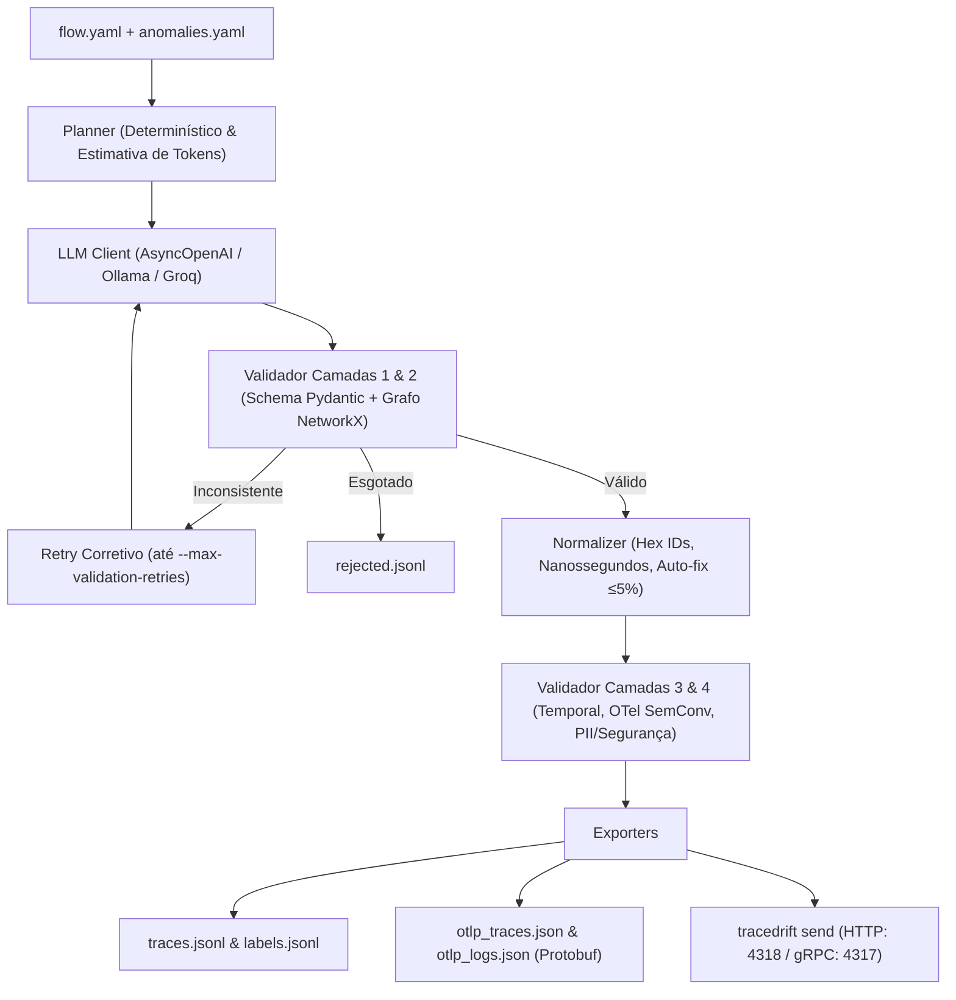

# TraceDrift

<p align="center">
  <strong>Gerador sintético de traces OpenTelemetry, logs correlacionados e anomalias de observabilidade.</strong>
</p>

<p align="center">
  <a href="https://github.com/PauloHFA/TraceDrift/actions"></a>
  <a href="https://www.python.org/downloads/"></a>
  <a href="https://opentelemetry.io/"></a>
  <a href="https://github.com/astral-sh/ruff"></a>
  <a href="https://mypy-lang.org/"></a>
  <a href="LICENSE"></a>
</p>

---

## 📌 Visão Geral

O **TraceDrift** é uma ferramenta de linha de comando (CLI) em Python que gera datasets sintéticos de rastreamento distribuído (spans) e logs estruturados no padrão **OpenTelemetry (OTel)**, simulando degradações realistas de microsserviços (ex.: *cascading timeouts*, *retry storms*, *database lock contention*, *cache stampede*, *circuit breaker tripping*, etc.).

### Casos de Uso:
- **Engenharia de SRE / Observabilidade**: Popular Jaeger, Grafana Tempo, SigNoz ou Elasticsearch com massa de teste realista sem expor dados reais (PII, tokens, IPs internos).
- **Engenharia de Machine Learning**: Criar datasets rotulados com verdade-terreno (`labels.jsonl`) para treino e benchmark de algoritmos de detecção de anomalias e análise de causa-raiz.
- **Desenvolvedores de APM**: Validar receptores OTLP HTTP/gRPC e parsers com garantia de conformidade Protobuf.
- **Treinamento & Demonstração**: Exemplos didáticos de padrões complexos de falha em arquiteturas distribuídas.

---

## 📐 Arquitetura: Estratégia Híbrida

Modelos de linguagem erram com frequência aritmética de inteiros de 64 bits (nanossegundos) e hashes hexadecimais. O TraceDrift utiliza a **estratégia híbrida**:
1. **LLM (Blueprint)**: Gera exclusivamente o desenho hierárquico com rótulos simbólicos (`s1`, `s2`), relações pai-filho, deslocamentos relativos (`offset_ms`) e durações em milissegundos.
2. **Normalizador Determinístico**: Atribui IDs hexadecimais (`trace_id` de 32 chars e `span_id` de 16 chars) reproduzíveis via semente aleatória (`--seed`), converte milissegundos relativos para nanossegundos absolutos Unix e aplica auto-ajuste de tolerância temporal ($\le 5\%$).
3. **Validação em 4 Camadas**: Schema Pydantic v2, grafo NetworkX (DAG acíclico e raiz única), regras temporais OTel (RNF01) e varredura de PII (RFC 5737 e RFC 1918).



---

## 🚀 Instalação Rápida

Recomenda-se o uso do [uv](https://github.com/astral-sh/uv) (rápido e compatível com lockfiles):

```bash
# Clonar o repositório
git clone https://github.com/PauloHFA/TraceDrift.git
cd TraceDrift

# Instalar o ambiente virtual e dependências
uv sync --all-extras
```

Ou com `pip`:
```bash
pip install -e ".[dev]"
```

---

## ⚙️ Configuração

Copie o `.env.example` para `.env` e configure o provedor compatível com OpenAI:
```bash
cp .env.example .env
```

Exemplo para OpenAI:
```env
OPENAI_API_KEY=sk-...
OPENAI_BASE_URL=https://api.openai.com/v1
OPENAI_MODEL=gpt-4o-mini
```

Exemplo para **Ollama local**:
```env
OPENAI_BASE_URL=http://localhost:11434/v1
OPENAI_API_KEY=ollama
OPENAI_MODEL=llama3:8b
```

---

## 💻 Comandos da CLI (`tracedrift`)

| Comando | Descrição |
| :--- | :--- |
| `tracedrift init` | Cria templates `flow.yaml` e `.env.example` no diretório atual. |
| `tracedrift plan` | Planeja a execução, distribuição de anomalias e estimativa de tokens (`--dry-run`). |
| `tracedrift generate` | Executa a geração assíncrona em lote com barras de progresso Rich e retomada (`--resume`). |
| `tracedrift validate` | Valida arquivos YAML de fluxo, traces internos ou arquivos OTLP Protobuf. |
| `tracedrift send` | Despacha traces para um coletor OTLP via HTTP (4318) ou gRPC (4317) com `--replay-realtime`. |
| `tracedrift report` | Gera relatório estatístico com percentis de latência e gera o `DATASET_CARD.md`. |
| `tracedrift visualize` | Renderiza waterfall e árvore de spans colorida com logs no terminal. |
| `tracedrift judge` | Executa avaliação LLM-as-judge (realismo, coerência de causa-raiz e riqueza). |

---

## 🛠️ Exemplos de Uso

### 1. Pré-visualizar o planejamento sem chamadas à API (`--dry-run`)
```bash
uv run tracedrift plan --flow configs/e_commerce_flow.yaml --count 50 --anomaly-ratio 0.2 --dry-run
```

### 2. Gerar dataset sintético
```bash
uv run tracedrift generate --flow configs/e_commerce_flow.yaml --count 50 --output datasets/demo/
```

### 3. Visualizar o gráfico em cascata (*waterfall*) no terminal
```bash
uv run tracedrift visualize datasets/demo/traces.jsonl --count 1
```

### 4. Validar conformidade Protobuf OTLP
```bash
uv run tracedrift validate datasets/demo/otlp_traces.json
```

### 5. Subir ambiente de demonstração (OTel Collector + Jaeger)
```bash
docker compose -f deploy/docker-compose.yml up -d
```
Abra a interface do Jaeger em: [http://localhost:16686](http://localhost:16686).

### 6. Enviar traces para o coletor em tempo real
```bash
uv run tracedrift send datasets/demo/otlp_traces.json --endpoint http://localhost:4318/v1/traces --replay-realtime
```

---

## 📚 Catálogo de 20 Padrões de Anomalias

O TraceDrift inclui um catálogo extensível ([`configs/anomalies_default.yaml`](configs/anomalies_default.yaml)) cobrindo as principais degradações distribuídas:

| # | ID da Anomalia | Mecanismo de Falha |
| :-: | :--- | :--- |
| 1 | `thundering_herd` | Cache miss maciço simultâneo saturando o banco de dados. |
| 2 | `database_lock_contention` | Concorrência de transações disputando bloqueios exclusivos de linha. |
| 3 | `circuit_breaker_tripping` | Abertura do circuito após falhas em downstream, rejeitando rapidamente com 503. |
| 4 | `downstream_network_partition` | Perda de conectividade com dependência externa gerando timeouts. |
| 5 | `retry_storm` | Retries exponenciais sem jitter multiplicando chamadas e saturando o serviço. |
| 6 | `thread_pool_exhaustion` | Esgotamento das threads do servidor retidas em chamadas bloqueantes. |
| 7 | `slow_consumer` | Consumidor assíncrono atrasando processamento e gerando acúmulo de lag na fila. |
| 8 | `n_plus_one_query` | Consulta inicial sucedida por dezenas de consultas seriais em loop. |
| 9 | `cache_stampede` | Expiração simultânea de chave de cache quente disparando regeneração concorrente. |
| 10 | `partial_db_failure` | Falha de réplica ou shard específico de leitura mantendo escrita funcional. |
| 11 | `cascading_timeout` | Timeout no serviço mais profundo propagando falhas sucessivas até o gateway. |
| 12 | `connection_pool_starvation` | Esgotamento de conexões disponíveis no pool de banco de dados. |
| 13 | `dns_resolution_delay` | Lentidão intermitente na resolução DNS antes do handshake TCP. |
| 14 | `garbage_collection_pause` | Stop-the-world GC pause dilatando simultaneamente todos os spans em execução. |
| 15 | `rate_limiter_throttling` | Rejeição HTTP 429 por estouro de cota configurada. |
| 16 | `deadlock_abort` | Detecção de ciclo de bloqueios pelo banco com abort imediato da transação. |
| 17 | `asynchronous_queue_overflow` | Fila AMQP/Kafka atingindo limite máximo e rejeitando mensagens. |
| 18 | `microservice_fallback_degradation`| Falha silenciosa com acionamento de fallback empobrecido ou em cache velho. |
| 19 | `hotspot_partition` | Partição ou nó de cluster recebendo tráfego desproporcional. |
| 20 | `memory_leak_latency_drift` | Degradação cumulativa e contínua de latência devido à pressão de memória. |

---

## 🧪 Testes e Qualidade

Execute a suíte de testes completa com medição de cobertura:
```bash
uv run pytest --cov=tracedrift --cov-report=term-missing
```

Verificação estrita de tipagem e linting:
```bash
uv run ruff check .
uv run mypy --strict tracedrift
```

---

## 📄 Licença

Distribuído sob a licença [Apache-2.0](LICENSE).
Copyright (c) 2026 TraceDrift Contributors.
